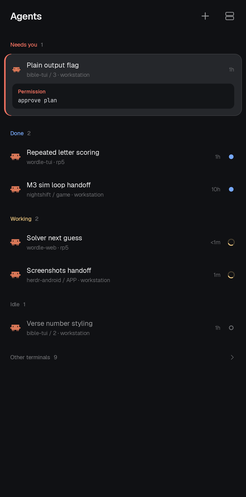
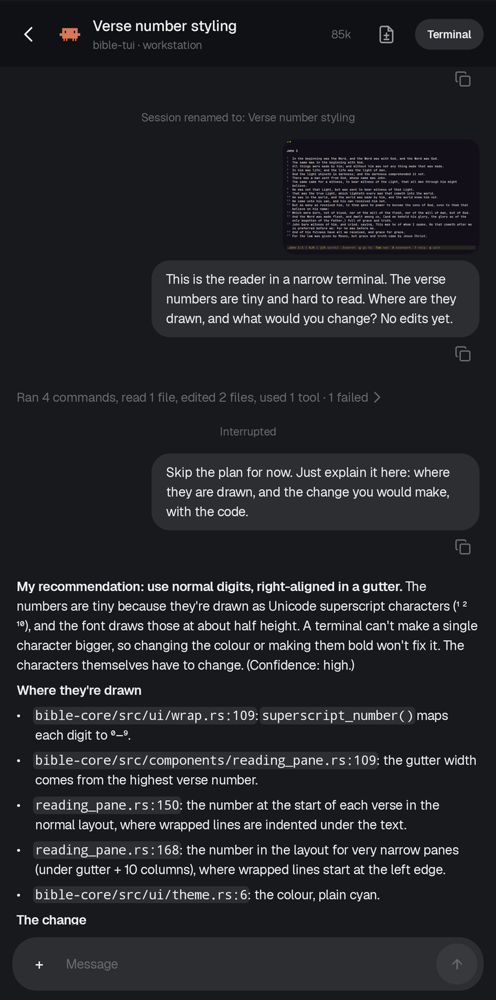
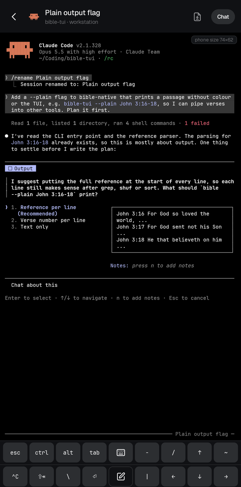
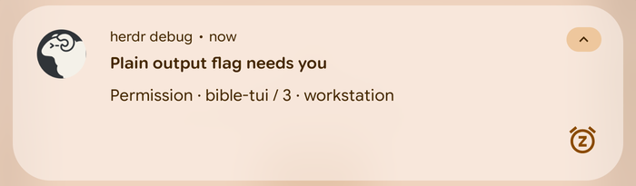

# kudde

Your coding agents, on your phone. kudde (Dutch for "herd") connects to
herdr-core on your own machines over SSH, lists every agent with the ones that
need you first, shows each as a live terminal or a chat, and lets you answer.
With the app closed, an encrypted alert tells you when an agent needs you or
has finished. Alerts go through your own ntfy server; no Google service is
involved.

kudde is an independent app built on [herdr-core](https://github.com/herdrdev/herdr-core).
It is not made by the herdr project.

  
  
  

  

Agents on a desktop ("workstation") and a Raspberry Pi in one list, one as a chat, one as its live terminal, and the alert it sent.

**Status:** 1.0. Complete for what it sets out to do, used daily by its
author, tested on a few phones, built on herdr-core 0.1.x.

## What works today

- **Agents:** every agent on every machine in one list, "needs you" first, then
  finished (not yet seen), working and idle. Each goes by its session's name
  ("Pricing page copy") and shows where it sits at the desk ("website / 2").
- **New terminals and agents:** start a terminal, or an agent installed on that
  machine (Claude Code, Codex and the others herdr knows), in one of the desk's
  spaces. It opens on the phone and shows up on the desk as a new tab.
- **Live terminal:** the terminal as the desk draws it, with colours, zoom and
  scrollback. Opening it switches the terminal to the phone's size. Type at the
  desk and the desk gets its size back while the phone keeps watching; exit the
  terminal's screen on the phone and the desk gets it back too.
- **Typing:** the phone keyboard and two rows of terminal keys (esc, ctrl, alt,
  tab, arrows, ^C and more). A compose sheet takes long prompts with
  autocorrect and dictation, and pastes them without pressing enter.
- **Chat:** switch an agent (Claude Code or Codex) between its terminal and a
  chat of its conversation: your messages as bubbles, answers as formatted
  text, tool calls folded into a line you can open, images you can open full
  screen, and a working line while the agent works. Answer from a message
  box, photos included; `/` and `!` commands work as in the agent's own box.
  When the app cannot read an agent's log, the terminal is all you see.
- **Changes:** a button on an agent's terminal and chat lists the files not
  committed yet in its repository, with lines added and removed, and shows
  each file's diff wrapped to the screen. It follows the agent as it works and
  only reads: nothing is staged, committed or discarded from the phone.
- **Alerts:** "Needs you" with sound, "Finished" silently, and a quiet warning
  when a machine has gone silent for 13 hours. Alerts name the session and
  where it sits. Tap an alert to open that agent's terminal. Mute per machine, and a test alert that checks the whole
  path.
- **Stay connected** (optional): keeps the connection open in the background,
  with a quiet notification that counts the agents that need you, have
  finished or are working, so the app opens at once. It uses more battery. On
  our test phone, with the screen off, it drew about 22 mA more on average
  (22 mAh an hour; phone batteries hold around 4000–5000 mAh). That phone was
  kept awake by other apps anyway: on a phone that would otherwise sleep, or
  with busier agents, it can be more. While the app is open the connection is
  there either way
  ([measurements](https://github.com/enhulsman/kudde/issues/16)). On
  GrapheneOS, the counts show on the lock screen only if it shows silent
  notifications.
- **Security:** the SSH key is made in the phone's secure hardware and never
  leaves it. It works for 30 minutes after you unlock the phone or use your
  fingerprint. You confirm each machine's host key once,
  and a changed key stops the connection.

## What you need

- An Android phone on Android 12 or newer (arm64).
- herdr-core 0.1.15 or newer
  ([herdrdev/kudde-core](https://github.com/herdrdev/kudde-core)) on a Linux
  or WSL machine. Install it as the user your agents run under:
  `curl -fsSL https://releases.herdr.dev/core/install.sh | sh`. The `herdr`
  terminal tool is a different program; the app does not need it.
  Each release of the app is tested against herdr-core 0.1.15 and the newest
  herdr-core of the day, and has been used daily with every version from 0.1.15
  to 0.1.21. A newer herdr-core connects too; an older one is refused with a
  message to update to 0.1.15 or newer.
- An OpenSSH server on that machine the phone can reach (for example over
  Tailscale). Tailscale SSH does not work: it ignores the phone key. If the
  machine runs Tailscale SSH, use its LAN address, or an OpenSSH port
  Tailscale does not take over.
- For alerts: an ntfy server, the ntfy app on the phone, and `kudde-push` on
  each machine.
- To install and update: [Obtainium](https://github.com/ImranR98/Obtainium),
  or adb on a computer.

## Setting up

1. **Install the app** through Obtainium, or with adb if Android blocks
   Obtainium; see [docs/install.md](docs/install.md). Check the first install
   and each update ([how](docs/install.md#checking-a-release)).
2. **Add a machine:** in the app, tap "Add machine" and enter its address, port
   and user. Compare the host key fingerprint the app shows with the
   machine's own: on the machine,
   `ssh-keygen -lf /etc/ssh/ssh_host_ed25519_key.pub` prints it. Then tap
   "Add the phone key", tap Copy, and get the line to the machine (a note or
   message to yourself works; the line is public). On the machine, run
   `mkdir -m 700 -p ~/.ssh && cat >> ~/.ssh/authorized_keys`, paste the line,
   press Enter, then Ctrl-D. The line lets the key run only herdr-core: no
   shell session, no forwarding. herdr-core can still run commands as that
   user, so treat the key like a shell login. The first connection starts
   herdr-core, so the card may show "Unreachable" once before it connects.
3. **Turn on alerts:** install `kudde-push` on the machine and turn alerts on in
   the app; see [docs/kudde-push.md](docs/kudde-push.md).

"Finished" alerts are silent by default. To hear them, open Android settings,
go to the app's notifications, open "Finished", and set it to alerting.

## Roadmap

Version 1.0 completes the loop: a view of an agent's git changes, plus the
work that lets someone else set the app up without help.

What is planned and what is being worked on now are tracked in the open:
the [v1.0.0 milestone](https://github.com/enhulsman/kudde/milestone/1)
and the [roadmap board](https://github.com/users/enhulsman/projects/4). Ideas
and bug reports are welcome as issues.

**Not planned:** closing or killing agents, editing spaces and tabs, a file
browser, custom theme files, pasting images into the terminal.

## Repository

- `android/`: the app (Kotlin and Jetpack Compose).
- `crates/`: the Rust core the app uses (SSH, the herdr-core protocol, the
  terminal engine) and `kudde-push`.
- `docs/`: guides for installing, releases and `kudde-push`, phone
  checklists, release notes.
- `openspec/`: the specification, and `decisions.md` the decisions behind it.
- `design/`: the signed-off screen renders.
- `THIRD_PARTY_NOTICES.md`: licences of the bundled material.

## Licence

Apache License 2.0; see [LICENSE](LICENSE). Bundled fonts and other third-party
material keep their own licences, listed in `THIRD_PARTY_NOTICES.md`.
